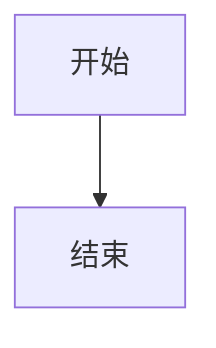

# 一级标题 Heading

中文段落，测试字体与行高。English text 123 with **bold**, *italic*, `inline code`, ~~strike~~, [link](https://example.com).

## 二级标题

> 引用块 quote block
> second line

- 无序列表 bullet one
- bullet two

1. 有序列表 ordered one
2. ordered two

- [ ] 任务 todo
- [x] 已完成 done

| Name | Value | Note |
| :--- | :---: | ---: |
| alpha | 1 | left |
| beta | 2 | right |

```js
const x = 1;
function hello() { return "world"; }
```



行内公式 $E = mc^2$，块级公式：

$$
a^2 + b^2 = c^2
$$


脚注引用[^1]。

[^1]: 这是一个脚注。

---

结束段落。
